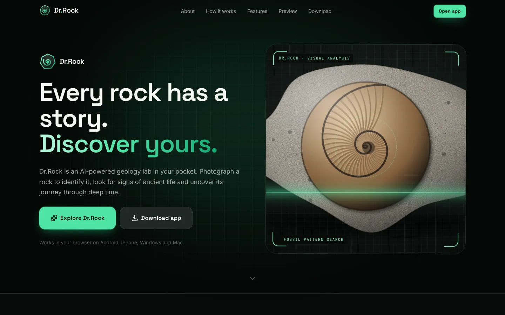
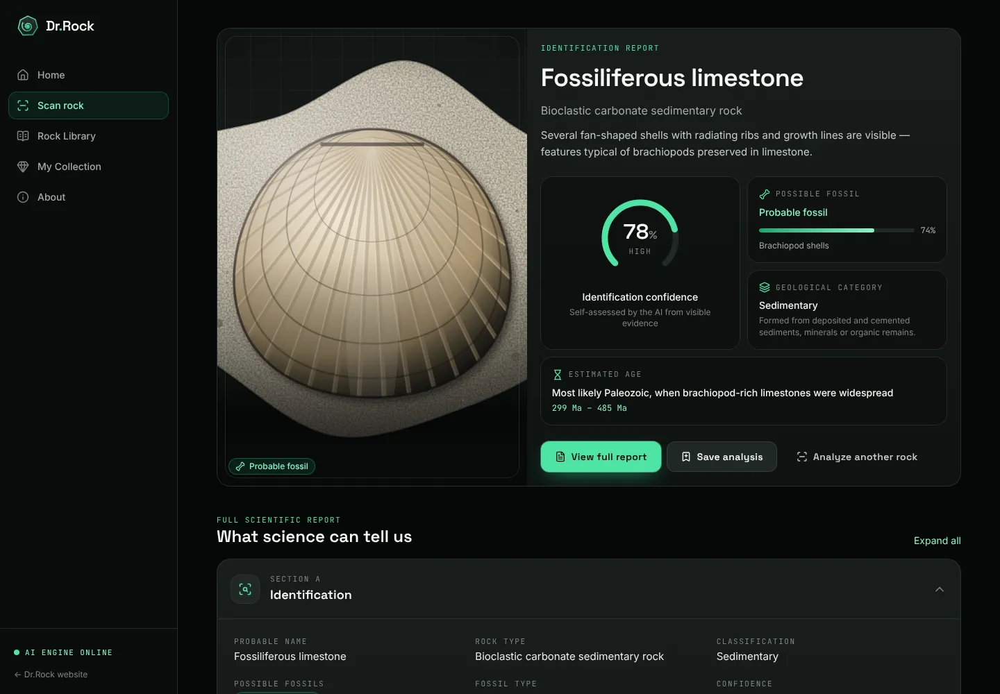
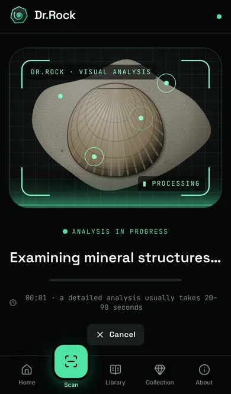
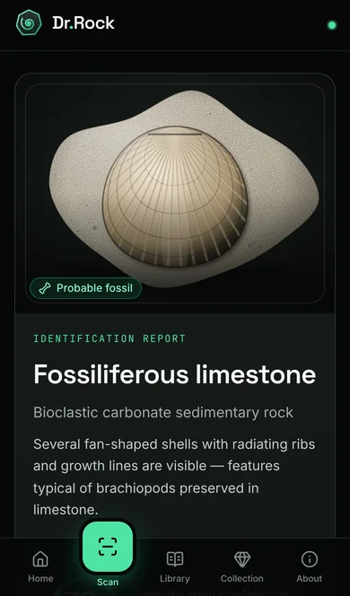
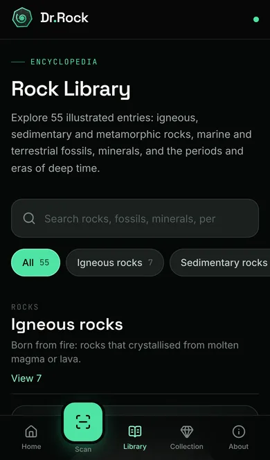

# Dr.Rock

> **Every rock has a story. Discover yours.**

Dr.Rock es una aplicación web progresiva (PWA) que analiza fotografías de rocas con un modelo de IA multimodal para identificarlas, buscar posibles fósiles y explicar su historia geológica. Incluye una enciclopedia geológica ilustrada, una colección personal y una landing page para presentar el producto.

| Landing | Resultados (escritorio) |
| --- | --- |
|  |  |

| Análisis (móvil) | Resultados (móvil) | Rock Library (móvil) |
| --- | --- | --- |
|  |  |  |

<sub>Las capturas de resultados se hicieron con un informe de ejemplo para la prueba automática; en producción el informe lo genera el modelo de IA.</sub>

## Funciones

- **Scan Rock** — hasta **3 fotos guiadas** del mismo ejemplar (vista general, primer plano y otra cara o escala). Cámara en vivo con linterna, zoom, toque para enfocar y foto a resolución completa (ImageCapture) cuando el dispositivo lo permite, con alternativa a la app de cámara nativa, subida de varias imágenes y arrastrar y soltar. Cada foto se prepara en el dispositivo: orientación corregida, 2576 px (la resolución máxima que lee la IA), metadatos EXIF eliminados (incluido el GPS) y un **control de calidad** que avisa si está desenfocada, oscura, quemada o con poca resolución. Si solo hay una o dos fotos y la original tiene más detalle, se añade un recorte automático del centro a resolución completa.
- **Pruebas de campo** — vinagre, dureza (uña / navaja / vidrio), imán, peso y color de la raya. La IA las interpreta con mineralogía estándar. Un medidor de "precisión de los datos" indica qué foto o prueba añadir para afinar.
- **Análisis con IA real en dos pasadas** — el backend envía las fotos etiquetadas a Claude (multimodal); la primera pasada redacta el informe y la segunda vuelve a mirar las fotos, lo revisa con una lista de comprobación (origen, alternativas, pseudofósiles y réplicas, confianza calibrada, datos) y lo corrige. Si la revisión falla se usa el primer informe. El informe JSON se valida con un esquema estricto. Nunca se muestran resultados inventados: si la IA no está disponible, la app lo dice.
- **¿Natural o hecho por personas?** — cada informe indica si el objeto es natural, natural pero trabajado por personas (cortado, pulido, teñido, tallado, restaurado, herramientas de piedra) o fabricado (hormigón, ladrillo, escoria, vidrio, resina, cristales de laboratorio), con su confianza, qué es probablemente, a qué imita y las pistas observadas. Un objeto fabricado nunca se presenta como fósil probable.
- **Historial** — cada análisis se guarda automáticamente en el dispositivo con sus fotos e informe (los últimos 30): se puede abrir, guardar en la colección, borrar o **volver a analizar con más fotos o pruebas**.
- **Cuatro veredictos de fósiles**: fósil probable · parece fósil, pero no es concluyente · sin evidencia visible · imagen insuficiente. Siempre con nivel de confianza y su justificación.
- **Informe científico** (secciones A–G): identificación, edad e historia (con escala geológica ICS, separando la edad de la roca y la del fósil), ubicación geológica (corteza, manto y núcleo), composición (escala de Mohs, densidad, porosidad), *Did you know?*, valor paleontológico, y calidad de la foto con cómo verificar la identificación.
- **Rock Library** — 55 entradas ilustradas: rocas ígneas, sedimentarias y metamórficas, fósiles marinos y terrestres, minerales, periodos y eras. Incluye buscador y filtros por categoría.
- **My Collection** — guarda análisis con su foto, añade notas y etiquetas, marca favoritos, filtra y ordena. Se guarda en el dispositivo (IndexedDB), con la arquitectura lista para cuentas y sincronización.
- **Español e inglés** — la app se abre en el idioma del teléfono (español por defecto) y el botón **ES | EN** cambia todo: pantallas, las 55 fichas de la Rock Library y el idioma en que la IA escribe el informe. La elección se guarda en una cookie (`dr-rock-lang`) y `src/proxy.ts` sirve la versión correspondiente sin cambiar las URL. Los textos están en `src/lib/i18n/messages/` y las fichas en español en `src/lib/library/data/es/`.
- **PWA instalable** — funciona sin conexión para la biblioteca, la colección y las páginas visitadas. El análisis requiere conexión.
- **Landing page** en `/` con hero, about, cómo funciona, funciones, vista previa, descarga (web app disponible ahora y apps nativas como próximas versiones, sin enlaces a archivos que no existen), FAQ y footer con aviso científico.

## Puesta en marcha

Requisitos: Node.js 20.9 o superior.

```bash
cd dr-rock
npm install
cp .env.example .env.local      # añade tu ANTHROPIC_API_KEY
npm run dev                     # http://localhost:3000
```

- Landing: `http://localhost:3000/`
- Aplicación: `http://localhost:3000/app`

### Variables de entorno

| Variable | Obligatoria | Descripción |
| --- | --- | --- |
| `ANTHROPIC_API_KEY` | Sí, para analizar | Clave de la API de Anthropic (créala en [platform.claude.com](https://platform.claude.com/)). Solo se lee en el servidor y nunca llega al navegador. |
| `DR_ROCK_MODEL` | No | Modelo de IA (por defecto `claude-opus-5-5`). |
| `DR_ROCK_EFFORT` | No | `low`, `medium`, `high` (por defecto), `xhigh` o `max`. `medium` responde más rápido. |
| `DR_ROCK_TIMEOUT_SECONDS`, `DR_ROCK_MAX_RETRIES` | No | Tiempo máximo por intento (por defecto 240 s, máximo 600) y reintentos (por defecto 1). Si el hosting corta las peticiones antes, bájalos (en Netlify no hace falta: el modo trabajo tiene 15 min). Sin modo trabajo, la segunda pasada solo se hace si la primera tardó menos de 110 s. |
| `DR_ROCK_JOB_MODE` | No | `netlify-background` en Netlify: cada análisis se hace en una función de fondo (hasta 15 min) y la app consulta el resultado, porque las funciones normales de Netlify se cortan a los ~30 s. |
| `DR_ROCK_REVIEW` | No | `off` desactiva la segunda pasada de verificación (más precisa, pero tarda y cuesta aproximadamente el doble). |
| `DR_ROCK_SERVER_FALLBACKS` | No | `off` para gateways de IA que no reenvían cabeceras beta (Netlify AI Gateway). Desactiva el modelo de respaldo ante rechazos. |
| `RATE_LIMIT_MAX`, `RATE_LIMIT_WINDOW_SECONDS` | No | Límite de análisis por cliente (por defecto 12 cada 600 s). |
| `NEXT_PUBLIC_SITE_URL` | Recomendada | URL pública del despliegue (metadatos). |
| `NEXT_PUBLIC_CONTACT_EMAIL` | No | Correo de contacto que aparece en el footer de la landing. |

Sin `ANTHROPIC_API_KEY` la app funciona (biblioteca y colección), pero el análisis muestra *"AI not configured"* y no genera ninguna identificación.

> **Cámara:** los navegadores solo permiten la cámara en vivo con **HTTPS** o en `localhost`. Para probar en el móvil durante el desarrollo, usa un túnel HTTPS o despliega la app. En cualquier caso, el botón *Use camera app* abre la cámara nativa del teléfono.

## Scripts

| Comando | Qué hace |
| --- | --- |
| `npm run dev` | Servidor de desarrollo |
| `npm run build` / `npm start` | Build y servidor de producción |
| `npm test` | Pruebas (Vitest): validación de imágenes, reglas científicas, rate limit, datos de la enciclopedia y la ruta `/api/analyze` con un stub de la API |
| `npm run lint` / `npm run typecheck` | ESLint y TypeScript |
| `npm run generate:assets` | Regenera las ilustraciones de la Rock Library (`public/library/*.svg`) y los iconos PWA a partir del código |

## Despliegue

La app necesita un servidor Node (la ruta `/api/analyze` protege la clave), así que **no puede alojarse en GitHub Pages**. Opciones recomendadas:

- **Vercel**: importa el repositorio, elige `dr-rock` como *Root Directory*, añade `ANTHROPIC_API_KEY` en *Environment Variables* y despliega.
- **Netlify**: `netlify.toml` ya está listo. Las funciones normales de Netlify se cortan a los ~30 s, así que configura `DR_ROCK_JOB_MODE=netlify-background` (el análisis corre en `netlify/functions/analyze-background.mts` y la foto se guarda en Netlify Blobs solo hasta que la función la recoge), `DR_ROCK_EFFORT=medium` y `DR_ROCK_SERVER_FALLBACKS=off`. Con el AI Gateway de Netlify (activo por defecto en planes de créditos) no hace falta `ANTHROPIC_API_KEY`: Netlify la inyecta y cobra en créditos. Si prefieres tu propia clave, añádela con alcance *Functions* y el gateway se aparta. Cualquier cambio de variables necesita un nuevo despliegue.
- Cualquier hosting con Node 20+: `npm run build && npm start`.

## Teléfono y PC

- **Android e iOS:** la carpeta [`../dr-rock-mobile`](../dr-rock-mobile) genera el APK de Android y contiene el proyecto de Xcode para iOS (publicarlo en la App Store requiere una Mac y una cuenta de Apple Developer). El APK que abre la versión publicada (cámara nativa, icono y pantalla sin conexión). La clave sigue solo en el servidor. El APK se publica en `public/downloads/Dr.Rock.apk` y se descarga desde la sección *Download* de la landing.
- **PC (Windows, Mac, Linux):** abre la dirección publicada en Chrome o Edge y pulsa el icono de instalar de la barra de direcciones (o *Instalar app* en la landing). Dr.Rock queda instalada como aplicación de escritorio, con su propia ventana y acceso en el menú de inicio.
- **iPhone:** en Safari, *Compartir → Añadir a pantalla de inicio*.

## Documentación

- [`docs/ARCHITECTURE.md`](docs/ARCHITECTURE.md) — arquitectura, tecnologías, cómo funciona el análisis, estructura del proyecto y la hoja de ruta de cuentas y sincronización.
- [`prisma/schema.prisma`](prisma/schema.prisma) — esquema de base de datos preparado para usuarios y descubrimientos (no se usa en la v1).

## Aviso científico

La identificación por fotografía es orientativa y no sustituye el análisis de un geólogo o paleontólogo profesional, las pruebas de laboratorio ni la datación radiométrica.
